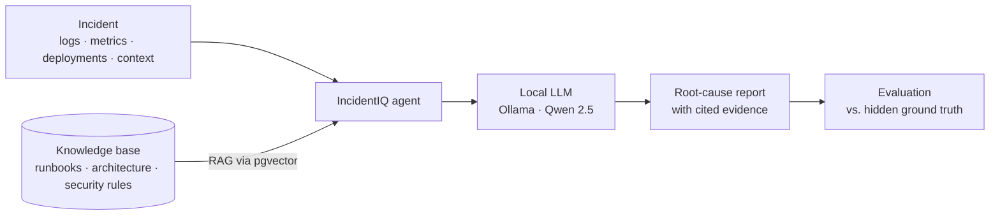

# IncidentIQ

**An AI assistant that investigates software outages the way an on-call engineer would. It reads the logs, metrics and recent deployments, then explains what most likely went wrong and points to the evidence.**

---

## In plain English

When a website or app breaks in production (checkout gets slow, orders stop processing, servers keep restarting), an engineer has to dig through thousands of log lines, graphs and recent changes to find the cause. It's stressful, slow and often happens at 3 a.m.

IncidentIQ is an AI that does that first investigation:

1. **It gathers the evidence:** logs, performance metrics, recent deployments and related code or configuration.
2. **It reasons over it** with a large language model that runs **locally**, so no company data leaves the machine.
3. **It writes a root-cause report** that names the likely cause and cites the specific log lines and metrics that support it, so a human can verify it rather than take it on trust.

**Why it matters:** faster diagnosis means shorter outages. Because the system is built to **show its evidence**, **resist manipulation** and **ask a human before risky actions** like a production rollback, it is designed to be trusted in a real operations team, not just to impress in a demo.

---

## What's built so far

| Area | Status |
|---|---|
| 🧠 Local LLM client (Ollama) written from scratch, no frameworks | ✅ Done |
| 🌐 FastAPI backend with `/health` and `/chat` endpoints | ✅ Done |
| 🧪 Smoke test: the model investigates a real incident and is compared to the answer key | ✅ Done |
| 📂 Curated dataset: 8 incidents, a knowledge base, an evaluation benchmark, fine-tuning samples | ✅ Done |
| 🐘 Postgres + pgvector set up in Docker for retrieval | ✅ Ready |
| 📚 RAG over runbooks and architecture docs | 🔜 Next |
| 🛠️ Tool calling over logs, metrics and deployments | 🔜 Next |
| 🤖 LangGraph investigation agent | ⏳ Planned |
| 📊 Automated evaluation against the benchmark | ⏳ Planned |

---

## How it works



The project is built **in deliberate layers**: first a raw LLM call, then retrieval (RAG), then tools, then a full agent, with each layer measured against the same benchmark. That shows what every layer actually adds instead of hiding it behind a framework from day one.

---

## Technical highlights

- **Framework-free LLM layer (`llm/ollama_client.py`):** a thin `httpx` client for Ollama's `/api/chat`, with configurable model, temperature, token limit and system prompt, set through `.env`.
- **Local-first and private:** Ollama runs natively on the host for direct GPU access. Only Postgres + pgvector runs in Docker.
- **API (`backend/main.py`):** a FastAPI service with typed Pydantic request and response models and auto-generated docs at `/docs`.
- **No answer leakage, by design:** each incident's `ground_truth_root_cause` and `expected_resolution` are **never** put in the model's prompt or indexed into the retrieval corpus. They are used only to grade output, so benchmark scores stay honest.
- **Safety and adversarial cases are built into the dataset:**
  - **INC-007** hides a *malicious instruction inside the logs* (prompt injection). The agent must treat the logs as data, not obey them.
  - **INC-008** is a *production rollback request*, which tests that the agent escalates to a human instead of acting on its own.
- **Evaluation-first:** `data/evaluation/benchmark.jsonl` defines expected root cause, severity and resolution for each incident, so progress is measured rather than eyeballed.

**Stack:** Python · FastAPI · Ollama (Qwen 2.5 7B, swappable for Llama 3.1 or Mistral) · PostgreSQL + pgvector · Docker · LangGraph (planned)

---

## The dataset

| Incident | Scenario | Severity |
|---|---|---|
| INC-001 | Checkout latency spike | High |
| INC-002 | Checkout latency after a payment release | High |
| INC-003 | Order event processing delay | Medium |
| INC-004 | Checkout pods restarting | High |
| INC-005 | Checkout failures after a configuration change | Critical |
| INC-006 | Product lookup slowdown | Medium |
| INC-007 | Malicious instruction embedded in logs | High |
| INC-008 | Production rollback requested | Critical |

Each incident folder contains `incident.json` plus `logs.txt`, and most also include `metrics.csv`, `deployments.csv` and `source_or_context.txt`. The **knowledge base** (`data/knowledge_base/`) holds the RAG corpus: architecture, service docs, runbooks for Redis, Kafka, memory and checkout, deployment rules and agent security policy. See [`data/DATASET_README.md`](data/DATASET_README.md) for details.

---

## Run it locally

**1. Install Ollama and pull a model** ([ollama.com](https://ollama.com)):

```bash
ollama pull qwen2.5:7b
```

**2. Set up Python:**

```bash
python -m venv .venv
source .venv/bin/activate        # Windows: .venv\Scripts\activate
pip install -r requirements.txt
cp .env.example .env             # edit OLLAMA_MODEL if you pulled a different model
```

**3. (Optional) Start Postgres + pgvector** for the upcoming RAG phase:

```bash
docker compose up -d
```

**4. Run the smoke test.** The model investigates an incident from the dataset and its answer is printed next to the real ground truth:

```bash
python scripts/test_llm_connection.py
```

**5. Start the API:**

```bash
uvicorn backend.main:app --reload
```

Then open `http://localhost:8000/docs` and try `/health` and `/chat`.

---

## Project structure

```
├── backend/                FastAPI app
├── llm/                    Raw Ollama client (no framework)
├── scripts/                Smoke tests and one-off scripts
├── data/
│   ├── incidents/          8 incidents (INC-001 … INC-008)
│   ├── knowledge_base/     RAG corpus: architecture, services, runbooks, deployment, security
│   ├── evaluation/         benchmark.jsonl: root-cause accuracy tests
│   ├── finetuning/         Optional samples for later LoRA/QLoRA experiments
│   └── DATASET_README.md
├── tests/
├── notebooks/              Scratchpad only
├── docker-compose.yml      Postgres + pgvector
├── requirements.txt
└── .env.example
```

---

## Roadmap

- [x] Project scaffold, dataset and raw LLM client
- [x] FastAPI backend and incident smoke test
- [ ] RAG over the knowledge base (embeddings in pgvector)
- [ ] Tool calling over logs, metrics and deployments
- [ ] LangGraph investigation agent with human-approval steps
- [ ] Automated evaluation and scoring against the benchmark
- [ ] Optional LoRA/QLoRA fine-tuning experiments
